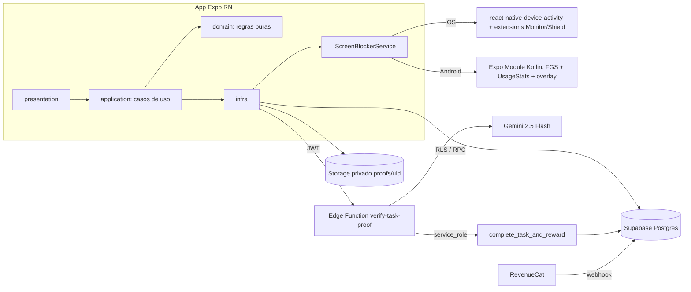
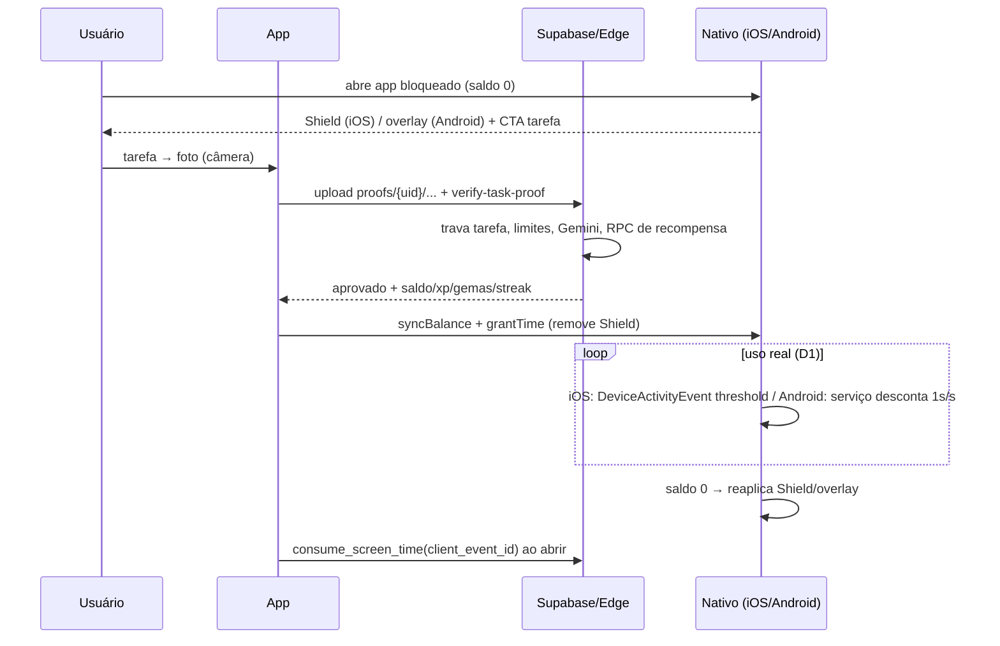

# Unscroll — Fase 0: Plano e Riscos

## Premissas (máx. 5)

1. **Sem verificação em rede nesta fase**: versões de Expo SDK / `react-native-device-activity` NÃO são fixadas aqui; a Fase 1 confirma compatibilidade (SDK, New Architecture) antes de instalar. `TODO(verificar)`.
2. Android primeiro para validar o loop (não exige conta paga); iOS só em iPhone físico, depois de contas Apple liberadas.
3. Distribuição inicial: builds internos (EAS `development`/`preview`). Play/App Store ficam para depois da aprovação das políticas/entitlement.
4. Um único projeto Supabase (sem staging) no MVP; migrations versionadas permitem recriar.
5. Valores de negócio (A.4) são fonte da verdade; o cliente só exibe o que o servidor devolve.

## 1. Arquitetura e fluxo de desbloqueio





## 2. Árvore de pastas final

```
unscroll-app/
├─ app/                      # expo-router (telas)
├─ src/
│  ├─ domain/                # streak, nível, recompensas (puro)
│  ├─ application/           # casos de uso
│  ├─ infra/{supabase,gemini,revenuecat,native}/
│  ├─ presentation/{components,screens,theme}/
│  └─ strings/pt-BR.ts       # textos de UI (i18n-ready)
├─ modules/screen-blocker/   # Expo Module local (android/ Kotlin, ios/ ponte)
├─ plugins/                  # config plugins (manifest, extensions, entitlements)
├─ supabase/{migrations,functions/verify-task-proof,tests}/
├─ app.config.ts, eas.json, tsconfig.json, babel.config.js, tailwind.config.js
└─ .env.example, README.md   # ios/ e android/ NÃO versionados (CNG)
```

## 3. Log de decisões

| #           | Decisão                                         | Prós                                                | Contras                                                                    |
| ----------- | ----------------------------------------------- | --------------------------------------------------- | -------------------------------------------------------------------------- |
| D1          | Consumo por **uso real** (não relógio)          | Justo; reforça o loop                               | iOS: depende de thresholds do DeviceActivity; Android: serviço sempre vivo |
| D1-fallback | iOS por janela de relógio (≥~15 min)            | Funciona se thresholds falharem                     | Impreciso; pode cobrar tempo não usado                                     |
| D2          | Saldo máx. 120 min                              | Evita estocar                                       | Frustra quem quer acumular                                                 |
| D3          | Limite diário no servidor (Free 1 / Pro 5)      | Anti-fraude real                                    | Free pode sentir pouco valor → conversão a validar                         |
| D4          | Streak com buraco proporcional (A.4)            | Mais justo que "1 congelamento por qualquer buraco" | Lógica de fuso/gap exige testes                                            |
| D5          | `app.config.ts` em vez de `app.json`            | Lê env, plugins condicionais                        | Menos estático                                                             |
| D6          | Upload → `imagePath` (não base64)               | Sem estourar payload                                | Mais um round-trip; precisa apagar foto                                    |
| D7          | Foto apagada pós-validação, guarda só path+hash | LGPD                                                | Sem auditoria visual de disputas                                           |
| D8          | `.individual` no iOS                            | Controle do próprio usuário                         | Usuário pode revogar em Ajustes                                            |

## 4. Matriz de riscos de plataforma

| Risco                                                                                                                                                                                                                                               | Prob.      | Impacto                        | Mitigação                                                                                                     |
| --------------------------------------------------------------------------------------------------------------------------------------------------------------------------------------------------------------------------------------------------- | ---------- | ------------------------------ | ------------------------------------------------------------------------------------------------------------- |
| **Apple Family Controls (distribuição)**: entitlement de distribuição exige aprovação manual; cada extension (Monitor, Shield Config, Shield Action) precisa do entitlement no seu bundle ID. Dev funciona sem aprovação, TestFlight/App Store não. | Alta       | Bloqueia iOS em produção       | Solicitar cedo; justificativa clara de autocontrole; enquanto isso, testar só em dev                          |
| **Google Play**: `PACKAGE_USAGE_STATS` e `SYSTEM_ALERT_WINDOW` são sensíveis (declaração/justificativa); Accessibility só para uso legítimo de acessibilidade e é frequentemente reprovado para bloqueadores.                                       | Média-Alta | Rejeição/remoção               | Usar UsageStats + overlay, **não** Accessibility; vídeo e texto de justificativa; evitar `QUERY_ALL_PACKAGES` |
| **Background Android 12+**: restrições a iniciar FGS do background; Android 14 exige tipo de FGS (`specialUse` com justificativa); OEMs matam serviços (otimização de bateria); iniciar Activity do background exige overlay/exceção.               | Alta       | Bloqueio falha silenciosamente | Notificação persistente, orientação de bateria, reinício em BOOT_COMPLETED, reconciliação ao abrir o app      |
| **Thresholds iOS (D1)** podem não disparar como esperado / limite mínimo de schedule                                                                                                                                                                | Média      | Consumo impreciso              | Protótipo em iPhone físico logo na Fase 4A; fallback documentado                                              |
| **Fraude de foto / custo Gemini** (foto de tela, reuso, spam)                                                                                                                                                                                       | Média      | Custo e abuso                  | Hash, limites por tarefa/dia, rate limit, rejeição no prompt                                                  |

## 5. Checklist manual (você)

- [ ] Conta **Apple Developer Program** (paga) → registrar iPhone com `eas device:create`
- [ ] Solicitar entitlement **Family Controls (Distribution)** à Apple (todos os bundle IDs: app + 3 extensions)
- [ ] `gh auth login` / `gh auth status` e `eas login`
- [ ] Criar projeto **Supabase** (anotar ref, URL, anon key; CLI logado)
- [ ] Gerar chave do **Gemini** (Google AI Studio) → só em `supabase secrets`
- [ ] Conta **RevenueCat** (+ produtos mensal/anual, trial 3 dias; webhook depois)
- [ ] Conta Google Play Console (para fase de publicação)

## Verificado / não verificado / dispositivo físico

- **Sei**: arquitetura, regras A.4/A.5, limites gerais das plataformas.
- **Assumi**: premissas 1–5; compatibilidade SDK↔libs (a confirmar na Fase 1).
- **Só em aparelho físico**: tudo de Shield/DeviceActivity (iOS), serviço/overlay/bateria (Android).
- **TODO(verificar)**: versão do SDK e da lib; exigências atuais de justificativa do `specialUse` no Play.

**Próximo passo:** Fase 1 — repositório e scaffold (aguardo seu "siga").
